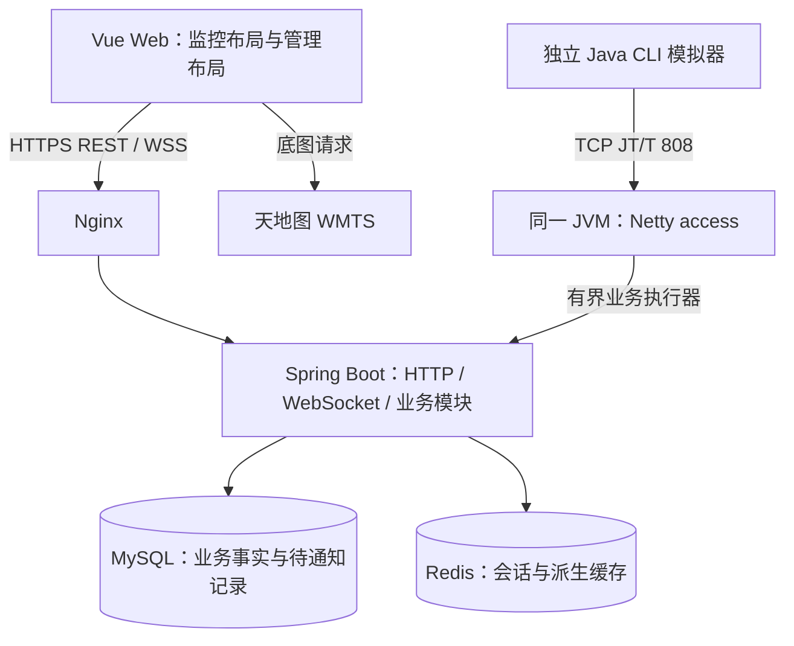

# 车辆监控系统设计方案

状态：Q1–Q50 已逐轮确认，用户已授权按 ticket 推进；当前实现覆盖 01 和 02，其余功能按依赖与验收逐步交付。

本文是当前设计入口，访谈依据见 [方案对齐](方案对齐.md)，业务术语见 [GLOSSARY](../../GLOSSARY.md)，关键取舍见 [ADR](../adr/)。表名、字段、API、默认工程参数属于实现基线，须在 migration 与接口实现中验证；未另经访谈的工程参数不伪称为用户逐项确认。

实现状态：任务 01（空环境启动与管理员登录）及 02（账号角色与车队授权）已有实现，验证分别见 [01-verification](../../.scratch/vehicle-monitoring/evidence/01-verification.md) 和 [02-verification](../../.scratch/vehicle-monitoring/evidence/02-verification.md)。02 的 HTTP 权限、锁定、会话、审计与三角色页面已有回归证据；最终状态以 ticket 为准。任务03已交付车辆与终端档案、历史绑定与转队，验证见 [03实施与验证记录](../../.scratch/vehicle-monitoring/evidence/03-verification.md)。其余功能仍为设计承诺。

## 1. 目标与边界

面向单家中小型道路货运企业、多车队，完成本科毕业设计。以独立 Java 模拟终端通过 TCP 发送 JT/T 808-2019 子集报文，展示注册鉴权、位置持久化、地图监控、历史轨迹、报警与处置、围栏、指令应答的可重复链路。真实车载终端互通是可选后续验证，不以模拟器通过代替标准完整符合性。

交付桌面 Web、一套后端、独立 CLI 模拟器及 Linux 单机 Docker Compose 配置；开发环境 Windows，预算单人约 10 周。容量目标为 100 终端、正常每 10 秒上报，位置约 10 条/秒、86.4 万条/天、30 天约 2592 万条。这些是估算，不是已测容量。

本期不交付调度、维保、证照管理、司机端、SaaS 多租户、集群高可用、809 级联、1078 视频、平台疲劳算法、夜间禁行、围栏停留计时、里程/油耗/利用率排名、导航与地址搜索、离线底图。

## 2. 技术栈

| 层 | 选型 | 约束 |
|---|---|---|
| Java 与构建 | JDK 21 LTS、Maven Wrapper | 根 POM 聚合三个模块 |
| 后端 | Spring Boot 4.1.x | 单实例、模块化单体 |
| TCP | Netty | dependency management 优先使用 Boot BOM，隔离 EventLoop 与阻塞业务 |
| 数据访问 | MyBatis-Plus Boot 4 starter | 常规 CRUD；关键统计、历史关联、批量 SQL 显式实现 |
| 登录 | Sa-Token Boot 4 starter | Redis 会话，不叠加 JWT |
| API | springdoc-openapi 3.x | HTTP 类型生成；WS 单独契约 |
| 持久化 | MySQL 8.4 LTS、Flyway | versioned SQL；MySQL 模块与 Flyway core 版本一致 |
| 缓存 | Redis | 会话与可重建快照，不承担唯一业务事实或幂等保障 |
| Web | Vue 3、TypeScript、Vite | Composition API、script setup、vue-tsc、ESLint |
| 前端配套 | Vue Router、Pinia、Element Plus、Axios | pnpm 与提交的 lockfile |
| 地图 | OpenLayers、天地图 WMTS 首选 | 道路+中文注记，key/地址/图层配置化 |
| 图表 | ECharts | 仅使用已确认统计指标 |
| Excel | Apache POI（工程默认） | 同步、最多 1 万行；字符串按文本写入，避免公式注入 |
| 部署 | Nginx、Docker Compose | server/web/mysql/redis；simulator 按需运行 |

具体 patch、Node/pnpm 版本和镜像 digest 在初始化阶段依据官方兼容信息及构建启动结果锁定，记录到 lockfile、POM 和 README。本文不把旧规划的精确版本表直接视为已经验证的依赖组合；若系列适配失败，应记录阻塞再修订设计，不能静默换架构。

地图引擎与底图服务分开。使用天地图前核对账户条款、额度、attribution 和开发/演示网络加载效果，未执行注册或付费操作。只按服务实际 CRS 做投影转换；原始位置保存 WGS84，不能把 Web Mercator 投影与 GCJ-02 偏移混为一谈。底图失败时保留列表、时间和错误提示，不伪装为地图已正常运行。

## 3. 总体架构与模块职责



这是一个后端部署单元，图中的 access 是同一进程的逻辑模块。初始工程默认 HTTP 8080、TCP 9000，Nginx 对外提供 Web；实际生产域名和 TLS 证书在部署阶段配置。mysql/redis 不暴露公网，开发确需宿主访问时仅在 localhost 的开发 override 中映射。

| server 包 | 负责 | 边界 |
|---|---|---|
| identity | 固定角色、账号、授权、会话版本 | 统一解析可访问车队；不依靠前端隐藏 |
| fleet | 车队、车辆、司机及关联历史 | 档案归属与关联生效区间 |
| terminal | 终端、车辆绑定历史与准入 | 预登记、停用、换绑控制 |
| access | TCP、连接、鉴权、应答、指令发送 | 唯一持有 Netty Channel 的适配层 |
| telemetry | 上报校验、幂等、事务、最新快照 | 组织位置驱动的状态计算 |
| track | 按车辆时间查询、分段、抽稀 | 保留原始数据，限制展示数据量 |
| alarm | 规则、持续事件、恢复、人工处置 | 异常生命周期与处置状态独立 |
| geofence | 几何、绑定与内外状态计算 | 输入有效实时点，计算不直接发 WS |
| reporting | 有权限的聚合、三类 Excel | 统一指标口径和导出白名单 |
| audit | 操作、登录、运行/维护记录 | 脱敏，不记录密码、鉴权码或 session token |
| infrastructure | 数据源、执行器、WS、任务与通知适配 | 不成为通用业务依赖集合 |

以接口调用明确协作，不让业务 Service 依赖 Channel。telemetry 在一个事务中协调位置和状态持久化；alarm/geofence 的计算逻辑便于独立测试。数据库 Mapper 不从 controller/access 任意绕过权限与事务服务调用。

## 4. 项目结构

```text
vehicle-monitoring-system/
├── pom.xml
├── mvnw / mvnw.cmd / .mvn/
├── protocol/
│   ├── pom.xml
│   └── src/{main,test}/java/     # 帧、消息、codec、独立 fixture 测试
├── server/
│   ├── pom.xml
│   └── src/
│       ├── main/java/<base-package>/
│       │   ├── identity/ fleet/ terminal/ access/
│       │   ├── telemetry/ track/ alarm/ geofence/
│       │   └── reporting/ audit/ infrastructure/
│       ├── main/resources/
│       │   ├── application.yml
│       │   └── db/migration/
│       └── test/
├── simulator/
│   ├── pom.xml
│   ├── scenarios/               # 正常、异常、故障的可重复配置
│   └── src/{main,test}/java/
├── web/
│   ├── package.json / pnpm-lock.yaml
│   └── src/
│       ├── app/                # 启动、路由、布局、权限入口
│       ├── features/           # 按业务组织 views/api/types/store
│       ├── map/                # 地图、车辆/轨迹图层、围栏交互
│       ├── shared/             # 无业务归属的组件和工具
│       └── generated/          # OpenAPI 生成类型，不手工修改
├── deploy/                     # 根 context 构建 server，含 Compose/Nginx/env example
├── docs/{agents,adr,design}/
├── .scratch/                   # 遵循 docs/agents/issue-tracker.md
├── GLOSSARY.md
└── README.md
```

`server → protocol`，`simulator → protocol`；protocol 可依赖 Netty，不依赖 Spring、MySQL 或 server。模拟器与服务端互不依赖业务代码，独立 fixture 不由同一 codec 自动生成。不存在已创建的上述业务目录；这里是待实施结构。

## 5. 页面与权限

登录后默认实时监控。监控布局包括实时地图、轨迹、报警、围栏与指令记录；管理布局包括档案、规则、统计、账号授权及审计。两种布局共用一次登录和 API Client。

| 操作 | 管理员 | 监控员 | 车队长 |
|---|---|---|---|
| 监控、轨迹、报警、统计与档案查看 | 全企业 | 全企业 | 授权车队 |
| 车辆/报警/处置 Excel | 全企业 | 全企业 | 授权车队 |
| 处置报警、发送两类指令 | 是 | 是 | 否 |
| 创建/编辑/停用围栏、绑定车辆 | 是 | 是 | 否 |
| 报警规则、基础档案、关联维护 | 是 | 否 | 否 |
| 账号授权、系统参数、系统审计 | 是 | 否 | 否 |

固定 ADMIN/MONITOR/FLEET_LEADER（工程默认 role_code），每账号一个角色，车队长可关联多个 fleet_id；不做权限设计器。车辆轨迹、事件详情、聚合、导出和 WS 订阅均在服务端限定范围。车队长可见围栏只展示授权车辆相关部分，不泄露完整绑定清单；报警处置历史与全系统审计分开。

普通用户可修改本人密码，管理员可重置密码；两类改密均撤销该账号已有会话。8 小时绝对到期，单账号单有效会话；后登录撤销旧会话，WS 最迟 5 秒停止旧授权推送。退出、停用、重置密码撤销会话；每次 HTTP 校验当前授权版本，WS 定期校验并在授权更新时主动刷新。连续失败 5 次锁 10 分钟，登录成功重置；工程增加来源速率限制避免单个账号锁定被滥用。初始管理员从部署配置一次性建立，无固定默认密码，不提供公网自助注册。

WS 默认通过已登录 HTTP 获取短时一次性 ticket 后握手，避免长期 session token 放入 URL；ticket 亦不得写日志。HTTP 使用 Sa-Token 随机会话 token，具体浏览器存储与传输封装在 identity Client，凭证不进入 URL、导出或日志。部署 TLS，开发 localhost 可使用 HTTP。

司机只收集 driver_no、name、phone、fleet_id、status，不采集证件号/影像。管理员/监控员可见完整电话，车队长中间四位掩码。三类导出不包含 phone、精确经纬度或凭证，车牌正常显示，授权地图仍提供必要位置。默认演示档案均标记模拟。

## 6. 数据模型设计基线

以下为建议的 22 张业务与支撑表，不为满足旧论文表数而设置；尚未建库。migration 设计时可在保持语义的前提下合并纯支撑结构，变更同步本文。

| 表 | 关键设计字段/约束 |
|---|---|
| sys_user | id、username、password_hash、role_code、status、auth_version、created_at、updated_at；username 唯一，role_code 与 status 由 CHECK 约束 |
| sys_user_fleet | user_id、fleet_id；联合唯一，限定车队长授权 |
| fleet | id、fleet_code、fleet_name、status；fleet_code 唯一 |
| vehicle | id、plate_no、fleet_id、status；plate_no 唯一 |
| driver | id、driver_no、name、phone、fleet_id、status |
| terminal | id、terminal_no、auth_secret_hash、status、last_seen_at、ever_authenticated；terminal_no 唯一 |
| terminal_vehicle_binding | id、terminal_id、vehicle_id、effective_from、effective_to；有效区间不重叠 |
| vehicle_driver_binding | id、vehicle_id、driver_id、effective_from、effective_to；每车同时至多一名关联司机 |
| vehicle_fleet_history | vehicle_id、fleet_id、effective_from、effective_to；转队历史，用于补传归属和历史权限 |
| track_point | id、terminal_id、vehicle_id、fleet_id_at_event、gps_time、received_at、lng、lat、speed、direction、alarm_flag、status_flag、locate_state、report_type、payload_hash |
| vehicle_last_position | vehicle_id、terminal_id、gps_time、received_at、lng、lat、speed、version；vehicle_id 唯一 |
| telemetry_anomaly | terminal_id、gps_time、received_at、reason、payload_hash、受限原始内容；异常/冲突可追溯 |
| alarm_rule | id、scope_type、fleet_id、alarm_type、parameters、enabled、version |
| alarm | id、vehicle_id、terminal_id、driver_id、fleet_id_at_event、source、alarm_type、condition_state、handle_status、start_time、last_time、recovered_at、rule_snapshot |
| alarm_handle_log | alarm_id、from_status、to_status、operator_id、remark、created_at |
| geofence | id、fence_name、fence_type、center_lng、center_lat、radius、vertices、status、version |
| geofence_vehicle | geofence_id、vehicle_id；联合唯一 |
| vehicle_monitor_state | vehicle_id、rule_version、活动报警引用、必要的围栏稳定状态/版本；持久判定状态 |
| command_log | terminal_id、vehicle_id、message_id、serial_no、connection_epoch、status、send_time、reply_time、reply_result、operator_id |
| notification_outbox | event_id（唯一）、event_type、aggregate_id、version、payload、status、retry_at、attempts；位置标记按车辆合并 |
| audit_log | actor_id、actor_name、category、action、target、result、source_ip、detail、created_at；操作/登录/运行日志分类，created_at 与 actor_id 建索引 |
| system_config | config_key、config_value、version、updated_by、updated_at |

表字段均为设计字段，不等于实际 schema。固定角色无需 sys_role/sys_menu/动态关联表。角色枚举和业务权限可测试；旧 sys_message、调度、维保、证照表不直接迁入。

任务 01 的 migration `V1__identity_and_audit.sql` 已落地 `sys_user` 与 `audit_log`：`audit_log` 增加 `actor_name`（登录失败时账号不存在也可追溯尝试的账号名）与 `source_ip`（登录来源），`sys_user` 增加 `created_at`/`updated_at`；这些是实现所需的支撑字段，语义未变。

任务 02 的 migration 已落地 `fleet`、`sys_user_fleet`（`V2__fleet_and_user_authorization.sql`）并在 `sys_user` 增加 `failed_attempts`、`locked_until`（`V3__login_lockout_fields.sql`）。`sys_user_fleet` 增加 `created_at` 记录授权建立时间；锁定状态持久化在账号行，跨重启保持；授权的失效通过提升 `sys_user.auth_version` 并比对会话中记录的版本实现，不单独增设会话表。表结构变化已回写本节。

任务03的 `V4__vehicle_terminal_history.sql` 已落地：`vehicle`/`terminal` 增加 `created_at`、`updated_at`；`terminal.auth_secret_hash` 在预登记时为 NULL，留待06注册生成；`terminal_no` 按2019头部预登记为20位数字。`terminal_vehicle_binding` 增加 `current_terminal_id`、`current_vehicle_id` generated columns，`vehicle_fleet_history` 增加 `id` 和 `current_vehicle_id` generated column，分别对非NULL当前引用建唯一约束。区间使用 `DATETIME(3)`，由服务端生成时间；同毫秒或时钟回拨无法形成有效区间时拒绝变更。新增 REST `/api/v1/vehicles`、`/api/v1/terminals`、车辆子资源 `/fleet`、`/terminal`、`/fleet-history`、`/terminal-bindings`；写端点限ADMIN，读端点按FleetScope校验；车队长不开放完整终端绑定历史以防跨队泄露，其车队归属历史按历史fleet_id过滤。工程默认还要求目标车辆与车队处于启用状态才可新建绑定或转入。表结构与行为已由真实MySQL与浏览器场景验证。

### 6.1 关键约束

- `track_point` 以 gps_time 日分区，唯一键 `(terminal_id, gps_time)`、主键需包含 gps_time；查询索引 `(vehicle_id, gps_time)`。数据库唯一键是正确性保障，payload_hash 仅比较同键内容，不作为唯一位置键。
- 对同键先到位置显式插入；只对预期唯一键冲突做内容比对，不用 INSERT IGNORE 吞掉截断、分区等错误。相同规范化位置内容幂等；不同内容写 telemetry_anomaly，正常位置不覆盖。报文流水号变化不应破坏位置幂等。
- 比对内容包括业务定位体及需保存的附加项，不把重传标识、包顺序、received_at 算成不同位置。未知 TLV 安全跳过，长度检查不可省略。
- 历史绑定区间采用 `[effective_from, effective_to)`，变更时锁定终端/车辆记录并检查区间，生效时间不倒填。当前一对一约束另用可唯一约束的当前引用/生成列落实；仅应用层先查再改不足以防并发重叠。
- terminal 换绑先停收旧会话再提交新绑定，不向旧车辆推送；按 gps_time 解析车辆与关联司机。终端、车辆、司机与车队 ID 稳定，不复用历史标识；已有业务引用的档案采用停用而非物理删除。不能判归属写异常，不猜测；同一持续报警固定开始时的 driver_id，不随司机换关联回写。
- 所有应用存取时间明确 Asia/Shanghai，gps_time DATETIME 表示协议的 UTC+8 定位时刻；received_at 保存接收时刻，两者不能互换。
- 轨迹保留默认按 Asia/Shanghai 日历日：今天和此前 29 天。提前维护未来分区，过期 drop 记录范围/结果；初始工程默认预建未来 7 天，启动与每日巡检。非法未来时间先拦截，不依赖分区错误兜底。
- 分区维护失败生成管理员可见告警并记录原因。缩短保留期先预览将删除的日期范围与估算影响，经管理员确认后生效，不随普通参数修改立即删除。
- 持续报警以 vehicle_id、alarm_type、source、规则/围栏业务维度及仅 ACTIVE 时非空的生成列建立唯一约束；同一维度最多一个 ACTIVE。瞬时 EVENT 不占用该约束，恢复按 alarm_id 和当前状态做条件更新，处置状态独立。数据库唯一性与状态行锁共同防止并发重复。
- 保留期外的新位置落受限异常摘要，不重新创建已过期轨迹分区。不自动清除报警、处置、历史关联与审计；轨迹清理不破坏仍被历史业务引用的信息。

- notification_outbox 用 event_id 唯一约束，状态 PENDING/RETRY/DONE/DEAD。工程默认重试最多 10 次后转 DEAD 并告警，管理员可审计重投；DONE 保留 7 天后清理，DEAD 不自动删除。位置通知为每车可合并的最新版本标记，worker 发送后只清除其读到的版本；并发更新更高版本必须保持待发送。报警/处置按独立事件记录，不能合并丢失。验收包含重复 enqueue、毒事件、worker 崩溃和版本覆盖。
- 定位无效但结构合法的点仍写 track_point，lng/lat 使用 NULL，原始状态与受限定位体用于比对；不伪造 0/0 或复用旧坐标。该点参与定位无效规则，形成轨迹分段标记，不更新有效位置快照。

### 6.2 权限与历史归属

车辆转队不重写历史事件归属：track_point 与 alarm 保存 fleet_id_at_event；补传点按 gps_time 对应的车辆车队归属解析，转队区间保存于 vehicle_fleet_history，变更同时写审计，不用当前 fleet_id 猜测。工程默认轨迹和报警均按事件车队授权读取，且轨迹查询需同时具备当前车辆访问权；转入车队不能因此看到转入前的其他车队轨迹，转出车队不能继续订阅该车新位置。历史报警/处置按事件车队授权保留可见，详情不附带当前越权位置或联系方式。管理员可跨队追溯，转队操作审计并撤销旧范围实时订阅；该默认口径在最终整体审阅时一并确认。

## 7. 位置与实时处理

1. EventLoop 分帧、反转义、长度/校验及头部版本检查，验证会话并解出消息；不执行阻塞数据库/Redis 业务。
2. 有界执行器按 terminal_id 串行；换绑等控制操作使用同一终端序列化边界。对同车的持久状态更新再用行锁/版本控制防任务并发。
3. 位置合法性检查、gps_time 对应绑定解析与幂等检查。正常点、定位无效点、异常记录走明确分支。
4. 一个 MySQL 事务保存位置或异常、单调最新有效快照、必要报警/围栏状态和待通知记录。历史点不驱动实时计算；无效坐标不进最新有效快照，但定位无效状态仍参与对应异常判定。
5. 提交成功后回 0x8001；再尝试缓存刷新与通知。Redis 或 WS 不可用不能拖延数据库成功应答，也不能撤销提交。
6. outbox worker 重试必要通知，以事件/版本幂等；位置帧只合并最近状态。新连接和重连以 REST 快照、列表校正，不做每浏览器的持久消息投递承诺。

`-30s ≤ received_at - gps_time ≤ 60s` 且不比已处理点旧、非显式补传的合法点，才是实时候选。未来不超过 30 秒属于容差，轨迹保留其真实 gps_time；超过容差写异常。工程默认容差内未来点仅作为历史轨迹持久化，不推进最新快照、报警或围栏水位，时间追上后也不追认或自动补算；后续正常实时点继续按单调 gps_time 推进，避免单个超前时钟冻结实时监控。显示最后通信/有效定位时间，停止更新时显示陈旧状态。历史有效点可补全轨迹，但不能回退最新位置或改变现时报警。

access 进程内的 Channel 注册表与 connection_epoch 是当前连接及应答关联的权威，Redis 只保留派生状态，不能凭 Redis 残留值发送指令或接受旧应答。合法 0x0003 注销按协议应答后关闭连接并撤销代次，在途指令 FAILED 并记主动注销；显示断开/未在线，不新造通信故障报警，已有 ACTIVE 不自动恢复。非主动断连后不再可发送，离线报警仍按 180 秒通信阈值成立。

同终端新连接鉴权成功后关闭旧连接，并使用 connection_epoch 区分会话；旧连接应答不能完成新会话指令。心跳等有效通信更新 last_seen_at，未鉴权包和损坏包不维持在线。队列满或持久化失败不返回成功，采取有界失败/断开与重传，避免无限堆积。数据库整体故障时只记录可用的运行日志，不能假称异常已落库。

0x0704 先整体验证长度与项数，再按同一包事务处理；ACK 成功表示该包各项均已正常保存、已幂等存在或已持久记录异常。结构损坏、数据库失败不能部分成功后回整包成功；模拟器按失败类型和次数上限重传。

REST `/api/v1`，WS `/ws/monitor` 为工程默认入口。接口资源按 auth/users/fleets/vehicles/drivers/terminals/tracks/alarms/alarm-rules/geofences/commands/reports/audit 划分。初始化时生成 OpenAPI，分页、错误码、字段验证和脱敏统一封装；不得用本文资源名声称接口已实现。

WS 连接先鉴权，订阅和每次输出按最新权限过滤。位置 2 秒合并，新报警/处置尽快通知；慢连接使用有界待发送缓冲和可见重连，不无限排队。frame 包含 event_id/aggregate_id/version/server_time，前端快照与流比较版本避免旧消息覆盖新状态。建立/重建订阅后再次获取快照与报警列表，补上初始查询至订阅建立间的变化。

### 7.1 轨迹查询与回放

一次查询一辆车，时间窗口最多 24 小时，可跨日但仍受权限与保留期限制；单次最多 2000 个展示点。先按无效定位标记或有效点间隔 >30 秒分段，再在各段内以米为单位使用 Douglas-Peucker 抽稀（工程初始容差 10m，逐步调整以满足点数上限）。首尾、分段边界与重要事件关联点优先保留，不跨断点抽稀；必要点已超限时提示缩小范围。实时尾迹也遵守断点规则。

前端按 gps_time 支持播放、暂停、拖动及 1/2/4/8 倍速；断点显示数据缺失，不连接为假路线、不跨断点连续插值。原始轨迹不修改、不另开批量导出入口。

## 8. 报警、围栏与指令

### 8.1 报警

来源分 PLATFORM/TERMINAL；终端 bit 映射仅实现核对过的类型，其余保留受限原始值，不编造语义。平台超速默认 >80 km/h 连续 3 点成立；工程默认恢复为 ≤阈值连续 3 点，暂不引入额外滞回。连续候选点间隔 >30 秒重置计数，ACTIVE 事件不随候选重置而消失。无效定位不计入超速成立或恢复，不自动恢复已有超速事件。

定位无效连续 3 个实时位置成立，连续 3 个有效点恢复。GNSS 故障位与“定位无效”保留具体原因，不能把未定位坐标拿去围栏计算。终端报告报警按支持位的状态变化形成持续事件或按规范标为无恢复语义事件，不按每个上报点新增一条。

已鉴权、启用、曾接入终端连续 180 秒无有效通信判离线，重连有效通信即恢复。服务启动 180 秒宽限；停用、主动解绑不伪造新的通信故障，已有 ACTIVE 事件保留并标注监控范围改变，未经实际恢复不改为 RECOVERED。

异常 condition_state 与 handle_status 独立。持续事件允许 ACTIVE 且 HANDLED；恢复事件可 RECOVERED 且 PENDING。本期一次处置终态后不重开，新的异常周期生成新事件。进出围栏是瞬时事件，condition_state 用 EVENT（工程表示）而非虚构恢复时间。没有证据证明相同事件的两种来源不强行合并。

### 8.2 围栏

圆与多边形；工程默认半径 10–100000m、多边形 3–20 顶点，拦截自交、退化与越界几何；页面预览与服务端验证同一几何。几何持久化 WGS84，显示层投影转换；地理计算使用米或适合区域的投影，不对经纬度直接用像素距离。

边界算内；首次点建立基线；连续 3 个有效实时点确认变化，相邻点 >30 秒候选重计。形状或绑定改变后重建围栏基线，不清除车辆其他 ACTIVE 报警或处置记录；重启不推测漏掉的进出事件。车队长只能看授权车辆相关绑定。

### 8.3 指令

只支持 0x8300 文本、0x8202 临时位置跟踪。工程默认文本最多 100 汉字并按实际 GBK 字节长度校验；跟踪间隔 1–60 秒、有效期最多 3600 秒，停止形态以协议核对结果为准，编码不超单包上限。

状态 SUBMITTED/SENT/ACK_SUCCESS/FAILED/TIMEOUT（设计枚举），成功仅表示终端应答接受。离线不排队等待上线；发送写日志、以终端/连接代次/流水号/应答消息 ID 关联；工程默认 30 秒超时、不自动重发下行指令，避免重复文本。需要重试时由有权限用户显式提交新指令，保留关联记录。迟到应答留痕，不覆盖已结束指令为当时成功。

## 9. 协议与模拟器

支持 ID 共 11 个：0100、8100、0102、0002、0003、0001、8001、0200、0704、8300、8202（均为十六进制）。仅 2019 版本，不分包/不加密，消息体 ≤1023 字节；0704 最多 20 项且仍按实际长度约束。未知、不支持或结构错误按可安全识别的请求回规范结果；校验损坏/无法确认身份的帧丢弃记录，不能给不可信头部拼正常 ACK。

实现前核对 2019 文本类型、鉴权的定长字段、0704 数据类型枚举及通用应答、8202 停止格式、标准修改单等。旧速查有未核项，不凭互测修正标准。未核对能力不宣称支持；必要时记录阻塞，而非悄悄扩展范围或伪造兼容。

预登记终端注册后生成鉴权码，服务端持摘要用于比对，正常日志不输出；模拟器通过注册应答取得本会话所需鉴权材料。模拟器数据与地图底图协调为 WGS84，CSV/配置输入声明坐标系，不能直接把 GCJ-02 路线当 WGS84。

模拟器 CLI 支持固定种子、固定路线、车辆数、interval、server 地址；场景包括正常、超速、围栏、定位故障、重连补传、重复/冲突、无应答重试和指令。重试工程默认 5 秒 ACK 等待、最多 3 次，支持人工故障场景调参；永久拒绝停止重试并说明原因。模拟档案/seed 单独命令生成，不放入正式 migration。

## 10. 统计与导出

指标包含车辆总数、当前在线数/离线数、今日报警数、待处理报警数、报警处理率、日期趋势、类型分布及车队聚合。在线只计启用且绑定在线终端的车辆，离线只计曾成功接入且满足离线条件的车辆；未接入、停用、主动断开/重启待确认状态单列，在线加离线不必等于总数。待处理工程默认指 PENDING，PROCESSING 另列处理中，避免混算。

统计遵循 Asia/Shanghai，今日 `[00:00, now]`；在线/离线/未接入/停用分别呈现，车辆总数与当前车队维度按当前档案，历史报警按事件 fleet_id_at_event。所有计算先限定数据权限。

处理率取所选 start_time 区间内的同一批报警，分子为当前 HANDLED/IGNORED，分母零显示“—”，标明包含误报。不按今日处理的历史报警数除以今日新增数。提供日期趋势、类型分布、车队在线与报警聚合，不输出里程油耗等未确认指标。

三类 Excel 最多 10000 数据行，超限明确提示，不静默截断。字段白名单脱敏与权限服务复用，排序稳定；审计记录过滤条件、行数、结果，不保存敏感文件正文。同步生成需超时与并发上限，失败不返回残缺成功文件。

## 11. 实施与验证

| 周 | 实施目标 | 可验证交付 |
|---|---|---|
| 1 | 初始化、兼容锁定、migration/身份/权限骨架 | 前后端启动、管理员初始化、空库升级、天地图试接 |
| 2 | 车队/车辆/终端/司机和关联历史 | 越权拒绝、换绑区间与审计 |
| 3 | codec/注册鉴权/CLI | 独立 hex fixture、坏帧、准入、会话替换 |
| 4 | 持久位置/幂等/outbox/WS | 提交后 ACK、重传、缓存失败、车辆实时显示 |
| 5 | 分区/轨迹/分段/回放 | 24h/2000点、断点、历史补传、清理边界 |
| 6 | 报警/围栏/状态机 | 连续点、首次基线、恢复与处置独立 |
| 7 | 指令/规则/统计/导出 | 应答关联、超时、指标分母、脱敏 |
| 8 | 故障恢复/权限失效/部署 | Redis与数据库故障、重启宽限、WS权限5秒 |
| 9 | 性能与容量查询、修复 | 100车30min；单独容量数据查询；实际报告 |
| 10 | 演示与论文证据整理 | 可重复脚本、截图、测试事实、论文映射修订 |

性能目标：100 终端每 10 秒、30 分钟，理论约 18000 点，以实际发送数为准；成功应答数据可追溯、重复不增行；接收至浏览器应用更新 p95 ≤3 秒。记录 hardware、版本、网络、样本与测量方法，不能把服务端发出时间代替浏览器收到时间；浏览器回传应用版本/测时用于同源观测。目标失败须如实记录，不预填通过。

容量验证另外生成明确标注的历史合成数据，目标覆盖约30天理论量级和跨日查询；清楚记录实际生成行数、磁盘、查询范围、执行计划与用时。不能由18000行测试宣称2592万行实测通过。

最低验收覆盖：codec独立字节、无效与未知消息、注册鉴权、ACK丢失、数据库中断、同秒冲突、旧点不倒退、换绑后补传归属、无效定位不计算围栏、3点去抖、超速恢复与处置分离、重启ACTIVE保留、权限变更、导出越权与公式文本、过期分区清理、outbox重试、命令超时/迟到应答、WS重连。

## 12. 当前状态与旧规划关系

已完成：需求访谈、术语、ADR、整合设计、只读核查；任务 01 的最小编译、migration、启动、登录与退出已在真实 MySQL 8.4 与浏览器验证（见 01 验证记录）；任务 02 的账号角色与车队授权、任务 03 的车辆终端档案与历史绑定、任务 04 的司机档案与关联历史已实现并验收（见各自验证记录），migration 至 V5；任务 05 的 JT/T 808-2019 正文子集 protocol codec 已通过独立 fixture 单测（见 05 验证记录）。未完成：其余业务工程、其余 migration、天地图 key 接入、性能及功能测试；05 不声明未取得的 2021 修改单覆盖。

`ja/explore/` 的旧19模块/24表/5角色、SpringBoot精确patch、90天轨迹、疲劳/调度/维保证照、70图等不再作为当前交付约束；旧正文保留为历史参考。旧测试表中预填通过不具有执行证据，旧 schema.sql 不得直接作为当前建库脚本。论文映射尚待按本设计与实际实现修订，原始 Word 未修改。

实现前仍需验证依赖兼容与天地图账户/网络条件；协议字段需正式资料及独立fixture核对。本稿记录工程默认值供最终整体审阅，不要求为可逆参数再次逐项访谈。整体共识确认不等于测试通过或已经完成代码。

## 13. 参考入口

- [Spring Boot 官方文档](https://docs.spring.io/spring-boot/)
- [MyBatis-Plus 安装](https://baomidou.com/getting-started/install/)
- [Sa-Token](https://sa-token.cc/)
- [springdoc](https://springdoc.org/)
- [Flyway MySQL 文档](https://documentation.red-gate.com/flyway/reference/database-driver-reference/mysql)
- [Vue TypeScript](https://vuejs.org/guide/typescript/overview)
- [OpenLayers](https://openlayers.org/)
- [天地图地图服务](https://lbs.tianditu.gov.cn/server/MapService.html)
- [OSM 瓦片使用政策](https://operations.osmfoundation.org/policies/tiles/)

这些链接提供实现与选型依据，不能替代本工程实际构建、账户条款与运行验证。
